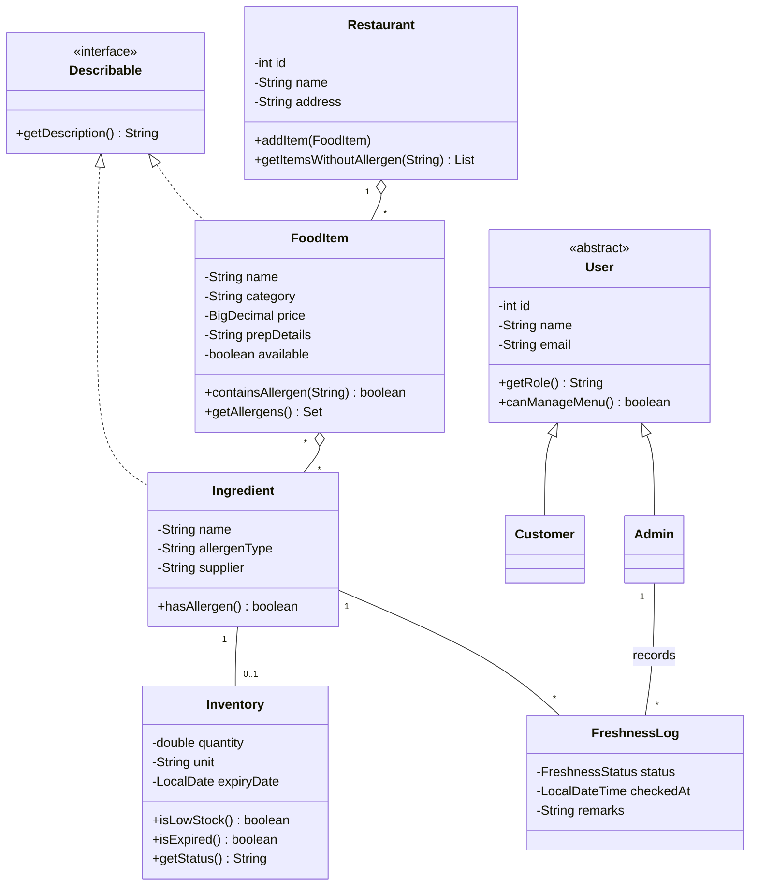
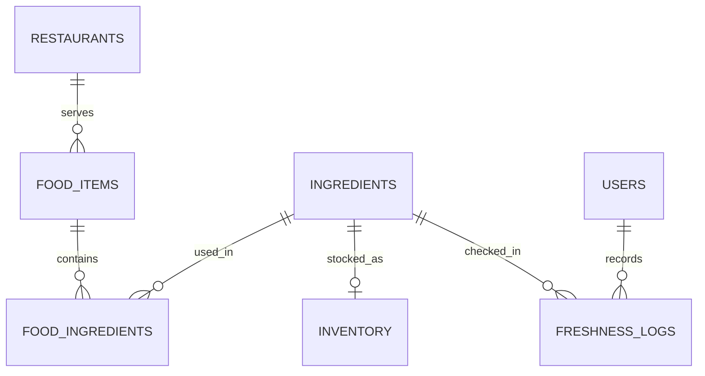

# Kiyoza: Design Notes

## Class diagram (Mermaid)

## ER diagram (Mermaid)

## OOP concepts and where they appear
| Concept | Where |
|---|---|
| Encapsulation | Private fields with getters/setters in every model class; `Inventory` hides its stock rules behind `isLowStock()`, `getStatus()` |
| Inheritance | `Admin` and `Customer` extend `User` |
| Abstraction | Abstract `User`; `Describable` interface |
| Polymorphism | `getRole()` / `canManageMenu()` overridden in `Admin` and `Customer`; `getDescription()` implemented differently by `FoodItem` and `Ingredient` |
| Composition / aggregation | `Restaurant` has `FoodItem`s; `FoodItem` has `Ingredient`s |
| Separation of concerns | model / dao / db / ui packages |

## DBMS concepts and where they appear
| Concept | Where |
|---|---|
| Primary and foreign keys | every table in `schema.sql` |
| Many-to-many relation | `food_ingredients` junction table |
| Normalization (3NF) | allergen and supplier live on `ingredients`, not repeated per dish; stock and freshness are separate tables |
| Constraints | NOT NULL, UNIQUE (email, ingredient name), CHECK (price >= 0), ENUM (role, status) |
| Cascading rules | ON DELETE CASCADE / SET NULL |
| Transactions | `FoodItemDAO.add` and `update` write a dish and its ingredient links atomically (commit/rollback) |
| Joins and subqueries | `FoodItemDAO.findAll`, `FreshnessLogDAO.latestByIngredient` |
| Prepared statements | all DAOs (prevents SQL injection) |
| Upsert | `InventoryDAO.save` (`ON DUPLICATE KEY UPDATE`) |
| Password hashing | SHA-256 via `UserDAO.hash`, same as MySQL `SHA2(x, 256)` |
